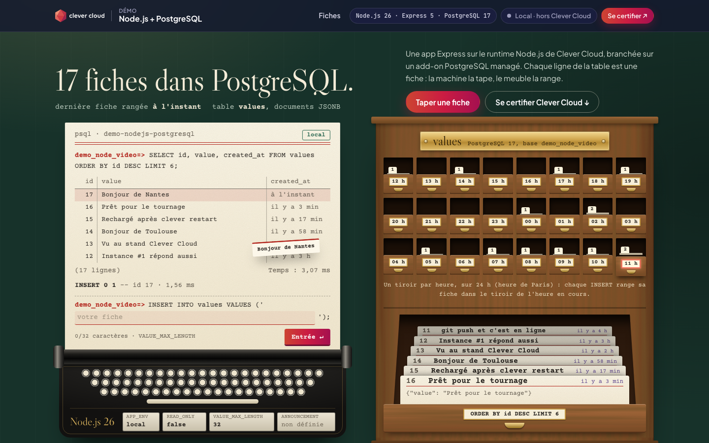
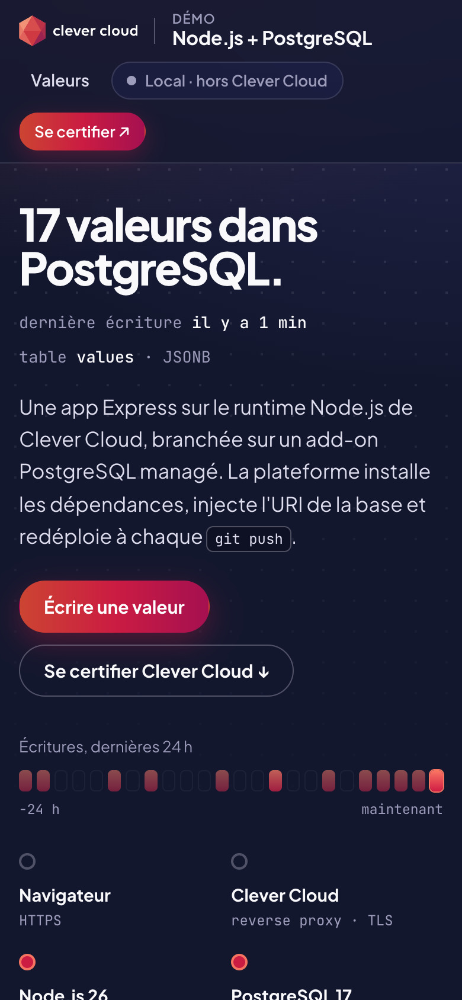

# The card catalogue — Node.js + PostgreSQL on Clever Cloud

> The card catalogue of an old library, where every row of a PostgreSQL table is an index card. On the left, the librarian's typewriter is a real psql session: the `SELECT` and its result are typed on the slip with the time the query took; type a value at the `INSERT INTO values VALUES ('…')` prompt, press Enter, and the slip answers `INSERT 0 1` while the new card flies into the drawer of the current hour. On the right, the oak cabinet has one drawer per hour over the last 24 hours (the write pulse), and the drawer opened by the `SELECT` shows the six latest cards. Express 5 runs on the **Node.js runtime**, the cards are JSONB documents in a **PostgreSQL add-on**, and the whole page is drawn from a single SQL query, printed further down. Four environment variables change what the page does, from a notice to a read-only database.





**Run it yourself.** The hosted demo was taken down after the presales review (November 2026). The steps in [Deploy on Clever Cloud](#deploy-on-clever-cloud) recreate it from scratch in about 5 minutes.

**Get certified.** This demo runs on Clever Cloud. To deploy your own apps the same way, get certified at the [Clever Cloud Academy](https://academy.clever.cloud/).

---

## What Node.js and PostgreSQL do here

| Where | Clever Cloud feature | What you see |
|---|---|---|
| Build | Node.js runtime: `npm install` (the default build tool), Node 24 from `engines.node`; `CC_CACHE_DEPENDENCIES` keeps the dependencies between builds | No Dockerfile and no build script: the runtime installs the dependencies and starts the app. The typewriter's nameplate reads the Node.js major version |
| Start-up | `scripts.start` → `node ./bin/www`, on the `PORT` the platform injects; the `values` table is created (or given its `created_at` column) before serving | No migration step. The app exits at startup if the database cannot be reached: link the add-on before the first deploy |
| Deployment check | `CC_HEALTH_CHECK_PATH=/health`: `SELECT 1` with a 2 s timeout, 200 or 503 | The platform validates each deployment against PostgreSQL |
| PostgreSQL add-on | `POSTGRESQL_ADDON_DIRECT_URI` when direct access is enabled, else `POSTGRESQL_ADDON_URI`, both injected by the linked add-on; a pool of `PG_POOL_MAX` connections | Title "N fiches dans PostgreSQL.", last card filed, one drawer per hour over 24 h with its card count, the six latest rows on the psql slip with `Temps : x ms` and in the open drawer, every card further down |
| Writes | `INSERT … RETURNING` and `DELETE`, each timed on the server | `INSERT 0 1` or `DELETE 1` typed on the slip, with the row id and the duration, the card filed in its hour drawer, without reloading the page |
| Environment variables | `APP_ENV`, `ANNOUNCEMENT`, `READ_ONLY`, `VALUE_MAX_LENGTH`, read once at startup | Shown on the four plates of the typewriter: environment tag on the slip, notice under the top bar, frozen database (writes answer 403, "Consultation seule" stamp), character counter. Change one in the Console, `clever restart`, reload |
| Platform variables | `CC_APP_NAME`, `APP_ID`, `INSTANCE_NUMBER`, `INSTANCE_TYPE`, `CC_PRETTY_INSTANCE_NAME`, `CC_COMMIT_ID`, `CC_DEPLOYMENT_ID` | The "Running on Clever Cloud" brass plate under the cabinet, with `instance #N` in the request path; "Local" and "injecté au déploiement" outside the platform |
| Redeploy | SIGTERM handled: no new connections, in-flight requests finish, the pool is closed, forced exit after 8 s | The old instance stops cleanly |

One query feeds the page: the total, the last write, 24 hourly counts and the 200 latest rows, aggregated in JSON. Its exact text is printed on the request slip ("Une seule requête SQL pour cette page."), next to the pneumatic tube that follows a request from the browser to the database. The `SELECT … LIMIT 6` typed on the psql slip is the readable form of it: the rows and the duration shown under it are real.

The page ends with the Clever Cloud Academy certification, drawn as a library reader's card.

---

## Deploy on Clever Cloud

You need [clever-tools](https://www.clever.cloud/developers/doc/cli/) (`clever login` done) and the ID of the organisation that will own the resources (`orga_…`, shown in the Console). Run the commands from the repo root: `clever create` links the folder to the new app.

```bash
# 1. The app and its size
clever create --type node demo-nodejs-postgresql --org <org_id> --region par
clever scale --min-flavor nano --max-flavor XS --min-instances 1 --max-instances 2

# 2. PostgreSQL (dedicated xxs_sml, encrypted at rest), linked to the app
clever addon create postgresql-addon demo-node-db --plan xxs_sml --option encryption=true --region par --org <org_id> --yes
clever service link-addon demo-node-db

# 3. Variables
clever env set NODE_ENV production
clever env set CC_HEALTH_CHECK_PATH /health
clever env set CC_CACHE_DEPENDENCIES true

# 4. Deploy
clever deploy
clever open

# 5. Optional: the 16 demo values (needs psql; reads the add-on URI with clever env, never prints it)
./scripts/reset-demo.sh
```

The table is created at the first start: without step 5 the page opens on an empty table. `scripts/reset-demo.sh` truncates it and loads `scripts/demo-seed.sql`: 16 values with dates relative to now, 14 of them in the last 24 hours. Run it again just before a demo so the ages and the hour drawers start from the present.

The script targets the app by its alias, `demo-nodejs-postgresql` by default (the alias `clever create` gives the app above). When several apps are linked to the same clone, or the app was created under another name, pass its alias: `CLEVER_ALIAS=<alias> ./scripts/reset-demo.sh`.

Variables left out on purpose:

- `CC_NODE_BUILD_TOOL=npm-ci`: `npm ci` deletes `node_modules` before installing, which cancels the dependency cache. The default `npm install` reuses it.
- `CC_NODE_DEV_DEPENDENCIES`: the project has no `devDependencies`.
- `CC_NODE_VERSION`: `engines.node` (`"24"`, the default version of the Clever Cloud image) takes precedence over it.

`node_modules/` is in `.gitignore`, as the Node.js runtime requires. An app created this way deploys from its Clever Cloud git remote: redeploy with `clever deploy`, a push to GitHub does not trigger it.

## Variables

| Variable | Set by | Role |
|---|---|---|
| `POSTGRESQL_ADDON_DIRECT_URI` | PostgreSQL add-on, when "Direct hostname and port" is enabled on it in the Console | Connection string, read first |
| `POSTGRESQL_ADDON_URI` | PostgreSQL add-on (linked) | Connection string, read when the direct one is absent |
| `PORT` | Clever Cloud | Listening port (8080; 3000 locally by default) |
| `CC_REVERSE_PROXY_IPS` | Clever Cloud | Trusted proxies, so `req.ip` and `req.protocol` reflect the client |
| `NODE_ENV` | you | `production`. Only `development` renders stack traces |
| `CC_HEALTH_CHECK_PATH` | you | `/health`: the deployment fails if it does not answer 2xx |
| `CC_CACHE_DEPENDENCIES` | you | `true`: build dependencies cached between deployments (default `false`) |
| `PG_POOL_MAX` | optional | Pool size per instance, default 4 (an invalid value gives 4). Keep `PG_POOL_MAX × instances`, doubled during a redeploy, within the plan's connections (`xxs_sml` = 45) |
| `ENABLE_PRIME` | optional | `true` mounts `GET /prime`, a deliberate CPU load, for the time of a load demo |
| `APP_ENV` | optional, demo | Tag on the psql slip, Clever gradient when `production`. Default `local` |
| `ANNOUNCEMENT` | optional, demo | Notice under the top bar of every page (160 characters max). Default empty |
| `READ_ONLY` | optional, demo | `true`: "Lecture seule" line under the title, the `INSERT` prompt becomes `-- READ_ONLY=true : écritures refusées`, a "Consultation seule" stamp on the slip, no "Retirer" buttons, `POST` and `DELETE` answer 403. Default `false` |
| `VALUE_MAX_LENGTH` | optional, demo | Maximum length of a value, 8 to 280, default 32: counter under the prompt, `maxlength` of the field and server-side check (400 beyond) |

A demo variable that is missing or invalid falls back to its default. No `.env` file is read: everything comes from the environment, locally as on Clever Cloud.

Two variables are read by the scripts only, never by the app: `CLEVER_ALIAS` (alias of the app whose add-on `scripts/reset-demo.sh` reloads, default `demo-nodejs-postgresql`) and `TEST_DATABASE_URL` (database used by the end-to-end tests of `npm test`).

## Routes

| Route | What it does |
|---|---|
| `GET /` | The page: psql typewriter, hour drawers, open drawer, request path and query, certification, every card |
| `POST /values` | Inserts a value: JSON `201` with the id and the duration when called by the page, a redirect for a plain form post; `400` when empty or too long |
| `DELETE /values/:id` | Deletes a value, returns the deleted count and the duration |
| `GET /health` | `SELECT 1` on PostgreSQL: `200 {"status":"ok","db":"up"}` or `503` |
| `GET /prime` | Only when `ENABLE_PRIME=true`: a CPU-bound computation that blocks the event loop for several seconds |

Writes answer 403 when `READ_ONLY=true` or when the browser sends `Sec-Fetch-Site: cross-site`. Every response carries a `Content-Security-Policy`, `X-Content-Type-Options: nosniff`, `X-Frame-Options: DENY` and a `Referrer-Policy`.

## Code tour

```
bin/www                 HTTP entry point (scripts.start), graceful shutdown on SIGTERM
app.js                  Express set-up: trust proxy, security headers, French relative ages, Paris hour labels,
                        error handler
config.js               the four demo variables, parsed once with safe defaults
db.js                   pg pool (PG_POOL_MAX), idempotent schema, the single page query (also shown on the page),
                        insert, delete, platform variables
routes/routes.js        GET /, GET /health, POST /values, DELETE /values/:id, GET /prime
views/                  layout (top bar, notice, footer), index (typewriter, cabinet, request path, all cards), error;
                        partials/ holds the Clever logo and badge (inline SVG) and the reader's card (certification)
public/js/demo.js       writes and deletes without reloading: psql log, the card's flight to its drawer, counters
public/demo.css         the card catalogue (wood, cards, brass, typewriter, all in CSS); public/cc-brand.css is the
                        Clever Brand Kit, copied as is
scripts/                demo-seed.sql (16 values) and reset-demo.sh (reloads the linked add-on, or DATABASE_URL)
test/                   config and view tests (no database), end-to-end tests when TEST_DATABASE_URL is set
clevercloud/node.json   historical start configuration (node ./bin/www), redundant with scripts.start, kept as is
```

Express 5, `pg` 8, Pug 3, morgan; no front-end build, no `devDependencies`, tests on the built-in `node --test`. Fonts come from Google Fonts: Libre Caslon Display for the engraved titles, Courier Prime for everything typed, Plus Jakarta Sans and JetBrains Mono for the Clever frame. The cabinet, the cards and the typewriter are drawn in CSS: no images.

## Run locally

```bash
npm install
createdb demo_node_video
DATABASE_URL=postgresql:///demo_node_video ./scripts/reset-demo.sh
POSTGRESQL_ADDON_URI=postgresql:///demo_node_video PORT=8101 NODE_ENV=production \
  APP_ENV=production ANNOUNCEMENT="Tournage en cours" npm start
# → http://localhost:8101

npm test                                                    # config and views, no database needed
TEST_DATABASE_URL=postgresql:///demo_node_video npm test    # plus real writes and reads (rows cleaned up)
```

MIT License.
